

  <a href="https://myself-om.vercel.app"></a>

  
  
  
  

 

  

 

  

 

  <a href="https://flow-forge-pi.vercel.app"></a>
  <a href="https://myself-om.vercel.app"></a>
  <a href="https://vocalise-ai.vercel.app"></a>
  <a href="https://myself-om.vercel.app"></a>
  <a href="https://akatsukis-endgame.vercel.app"></a>
  <a href="https://secure-q-gen.vercel.app"></a>

  🔒 Most of my production work lives in private repositories. Click a <b>LIVE</b> card to try it, or reach out for a code walkthrough.

<b>📂 More projects</b>

 

| Project | What it is | Stack | Link |
| :-- | :-- | :-- | :-- |
| **No-AI Expense Tracker** | Full-stack personal expense tracker | React · Express · MongoDB | [live](https://no-ai-expense-tracker-frontend.vercel.app) |
| **Learn SQL** | In-browser SQL playground: queries run locally via WebAssembly | Next.js · sql.js · IndexedDB | [live](https://learn-sql-mu.vercel.app) |
| **CampusDrive** | Campus placement platform (monorepo, Dockerised) | React · TanStack Query · Zustand · Zod | 🔒 private |
| **HaritPath** | Civic-issue reporting with geospatial hotspots and field-worker dispatch | React Native · Next.js · Express | 🔒 private |
| **Twiller** | MERN social media app shipped during my Nullclass internship | MongoDB · Express · React · Node | [repo](https://github.com/OmB-tech/TwitterClone) |
| **Akatsuki Project Hub** | Project showcase hub for the Akatsuki Coding Club | React · TypeScript · Vite | [live](https://projecthub-zeta.vercel.app) · [repo](https://github.com/OmB-tech/Akatsuki-Project-Hub) |
| **StudyGini API** | Backend for a study-companion app | Node · Express · MongoDB | [live](https://study-gini-backend.vercel.app) · [repo](https://github.com/OmB-tech/StudyGini-backend) |
| **College Predictor** | Estimates a student's admission chances | HTML · CSS · JavaScript | [repo](https://github.com/OmB-tech/College-Predictor) |
| **Portfolio** | My personal site with live GitHub &amp; LeetCode stats | Next.js 15 · GSAP · Framer Motion | [live](https://myself-om.vercel.app) |
| **Java DSA** | Data-structures &amp; algorithms practice log | Java | [repo](https://github.com/OmB-tech/Java-DSA) |

 

| Project | AWS services |
| :-- | :-- |
| 🐾 [**WildEye Detection**](https://github.com/OmB-tech/Wildlife-detection) Identifies wildlife species from photos and keeps sighting stats | Rekognition · Lambda · API Gateway · S3 · DynamoDB |
| 🎭 [**Emotion Detector**](https://github.com/OmB-tech/Emotion-Detector) Serverless human-emotion analytics dashboard | Rekognition · Lambda · S3 · DynamoDB |
| 🚀 [**Attendance CI/CD**](https://github.com/OmB-tech/CI-CD-Pipeline-for-Attendance-Application---AWS) Attendance app that auto-deploys on every push | CodePipeline · CodeDeploy · EC2 · Nginx · DynamoDB |
| 🗳️ [**Pollify**](https://github.com/OmB-tech/AWS-Pollify) Minimal real-time polling SPA | EC2 · DynamoDB |
| 🎬 [**Movie Booking**](https://github.com/OmB-tech/Movie-booking-site) Seat-selection movie ticket booking with SNS notifications | API Gateway · Lambda · DynamoDB · S3 · SNS |
| 🧾 [**Jaggery Requirement**](https://github.com/OmB-tech/Jaggery-Requirement-using-Pably-Connect) Requirement intake automated with Pabbly Connect | API Gateway · Lambda · S3 |
| 👤 [**Face Detection**](https://github.com/OmB-tech/aws-rekognition-face-detection) Face detection scripts in Python | Rekognition |

 

  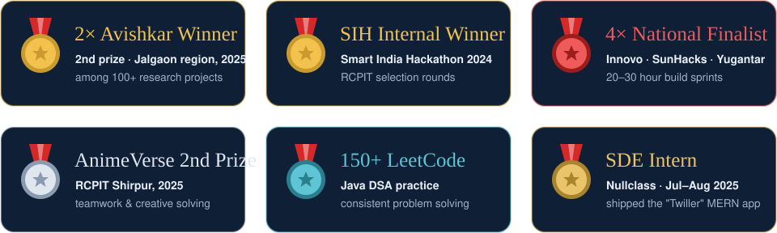

 

  
  

 

<a href="https://myself-om.vercel.app">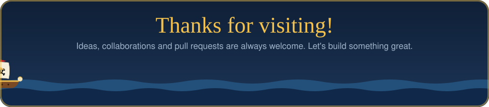</a>

  Every graphic here is a hand-built SVG stored in this repo. The stats are refreshed daily by GitHub Actions, with no third-party widgets to go down.

